# PixelExtraParts — гид пользователя

Одно приложение — **Pixel Extra Parts** — держит допы прошивки.
Без рута. Без лишних модулей. Просто работает.

Где искать:

- Дравер → **Pixel Extra Parts**
- Настройки → пункт **Pixel Extra Parts**
- Плитки быстрых настроек — долгое нажатие открывает страницу

📱 Главный экран — что видно первым

Поиск сверху, группы: **System**, **Misc**, **SystemUI**, **Camera**.
Плавающая кнопка: добавить плитку, рестарт лаунчера / SystemUI, ребут.

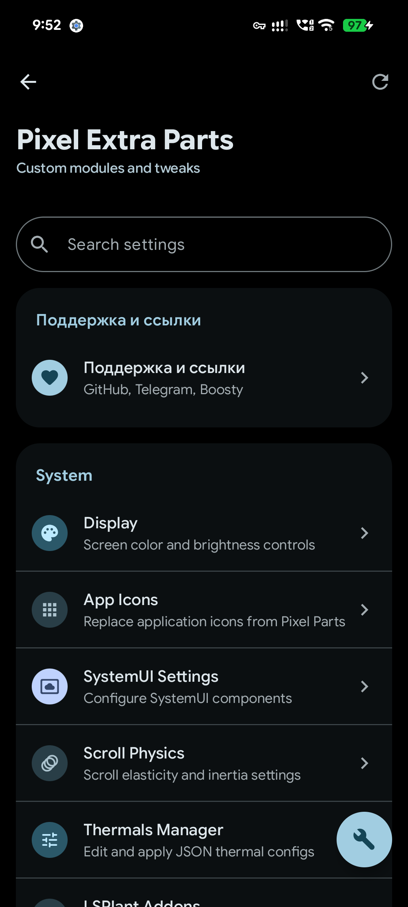
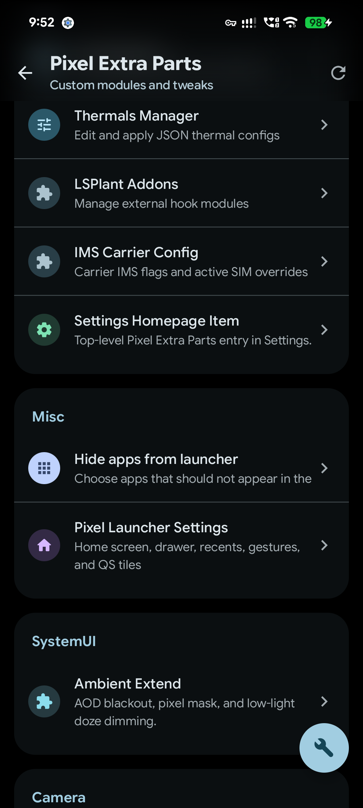
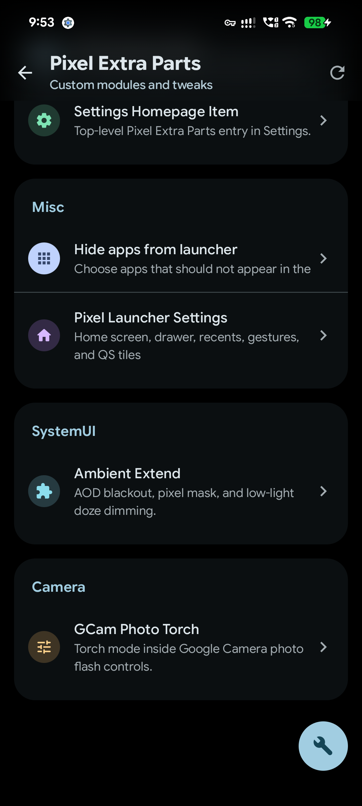

Круглое меню (последний скрин): **Show on desktop, Add app tile,
Restart Launcher, Restart SystemUI, Reboot System, Close**.

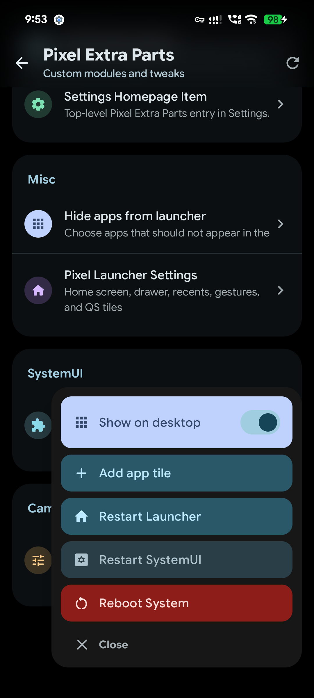

---

## Экран

`Pixel Extra Parts → Display → Screen`

📂 Хаб Display (4 строки)

- Saturation — сила цвета
- AutoHBM — буст на солнце
- Double Tap to Wake
- Auto lock

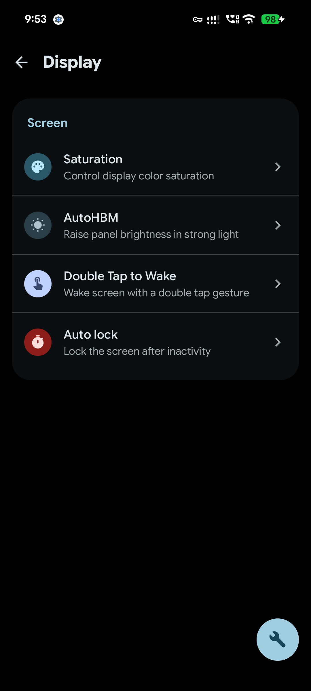

🎨 Насыщенность

- Превью-фото со стрелками, точками, **100%**.
- **Use custom saturation** — выкл на скрине. Выкл = обычно.
- **Saturation level — 200%** серым, пока тумблер выкл.
- Кнопка **+ Add Saturation tile**.
- Внизу: системный цветовой режим может перебить значение.

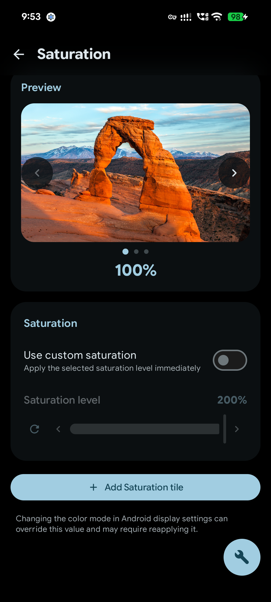

☀️ Буст на солнце (AutoHBM)

Верхняя карточка, живые цифры со скрина:

- **Current light level — Monitoring — 14**
- `Threshold: 4289 lx • Brightness: 1052/3827 • Tensor G3: 35.0°C`
- **Lux check interval — 250 ms**

Тумблеры:

- **Enable automatic HBM — ON**
- **Permanent HBM — OFF** (максимум всегда, без датчика)
- **Lock brightness — ON**
- **Light threshold — 4289 lx**
- **Enable delay — 0 s**
- **Disable delay — 1 s**
- **Smooth rise — ON, Ramp 800 ms**
- **Max time — 1396 s, Cooldown 60 s**
- **Лимит чипа — 80°C**

Пересидка или перегрев гасят буст с тостом, потом восстанавливают.
Уведомление: люксы / пик / блок + кнопки Disable и Lock.
Плитки: **AutoHBM**, **HBM**.

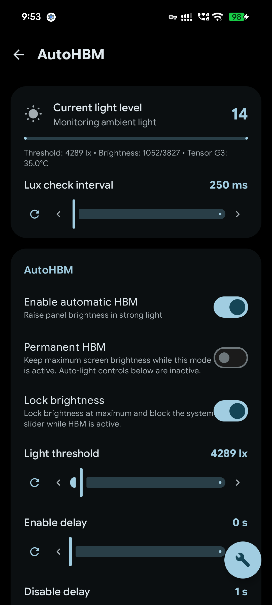
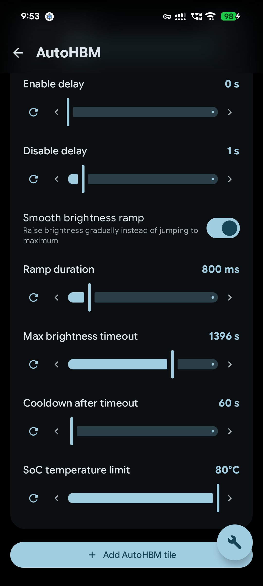

👆 Двойной тап

- **Enable DT2W — ON**
- **Tap count — 2**
- **Tap timeout — 483 ms**
- **Coordinate check — ON**
- **Allowed second-tap area** — превью с контуром телефона.
  В тексте: это только превью, а не точка для тапа.
- **Max distance — 240 dp** (второй скрин: 227 dp).

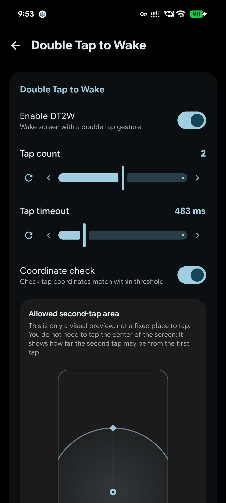
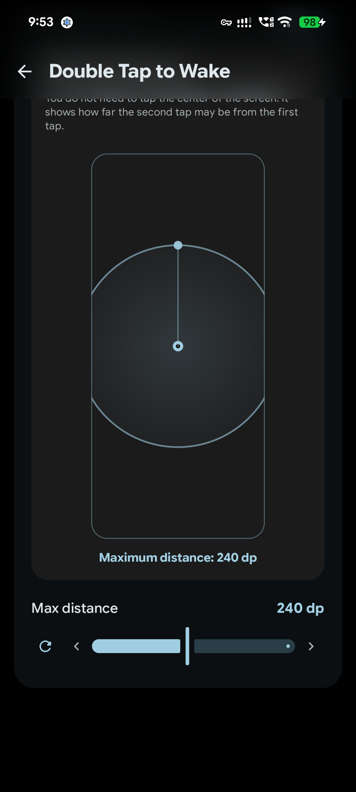
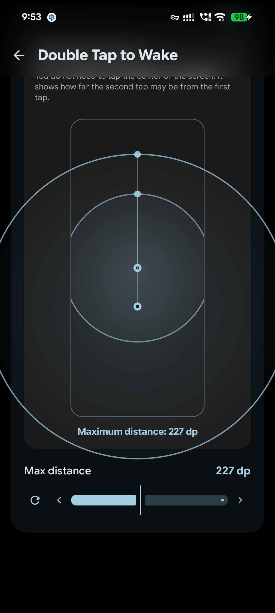

🔒 Автоблок

- **Auto lock — ON** (для видео / приложений без сна)
- **Only when needed — ON**
- **Pause media — ON**
- **Inactivity timeout — 543 sec / 9 min 3 sec**
- Подпись: время без касаний до блока.

Любое касание или кнопка сбрасывают таймер.
Плитка крутит Выкл → Вкл → Умный.

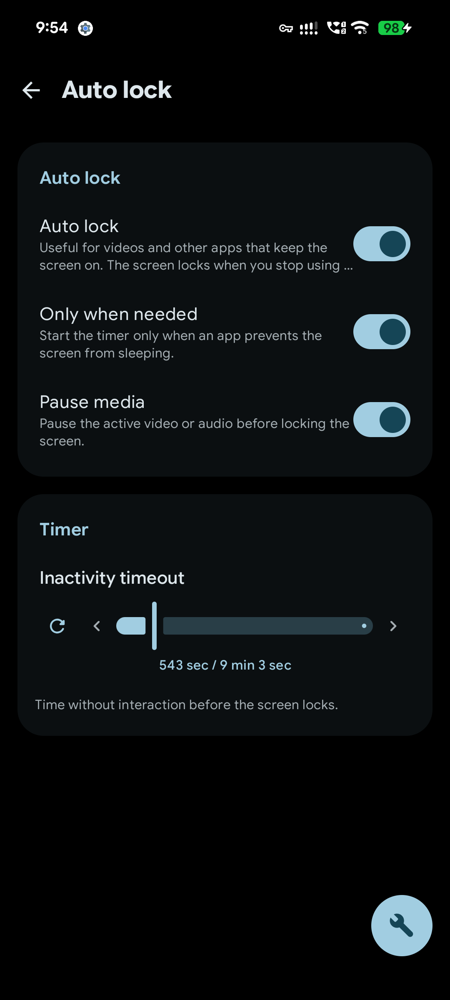

---

## Иконки

`Pixel Extra Parts → App Icons`

📂 Хаб иконок

Сверху группа **Advanced**:

- **Icon shape** — пресеты и свои формы.
- **Settings icon style override** — глобальная маска.
- **Advanced icon settings** — форма, тинт, правила лаунчера.

Далее **Icon packs (1 pack)**, затем **All applications (114 / 628)**.

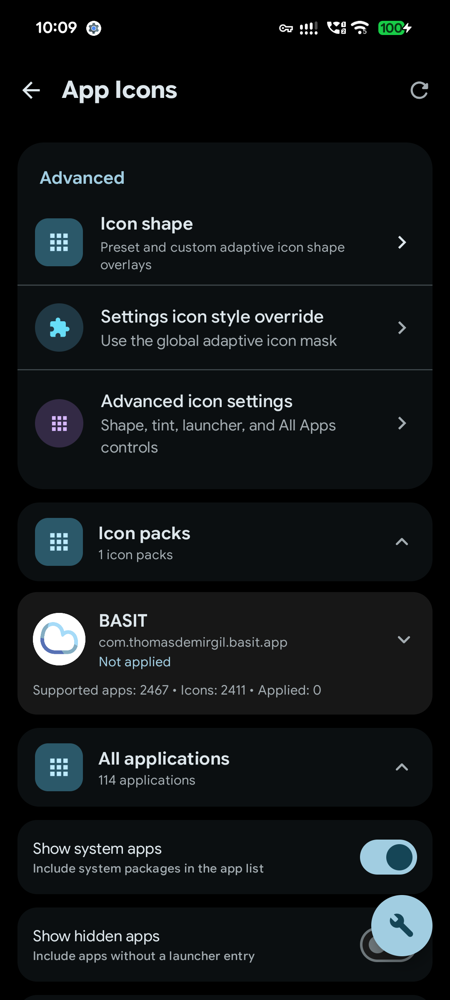
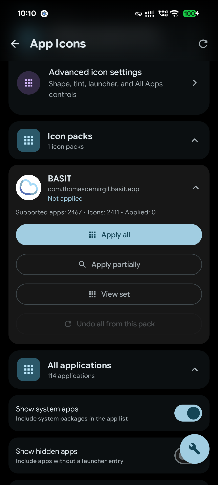

🎭 Паки и список приложений

- Карточка пака: имя, пакет, **Not applied**, *Supported / Icons / Applied*.
- **Apply all, Apply partially, View set, Undo all.**
- **Show system apps — ON, Show hidden apps — ON/OFF.**
- Поиск по имени или пакету.
- Строки: **Icon pack not applied**.
- С системными вкл: системные записи (например 3 Button Navigation Bar).

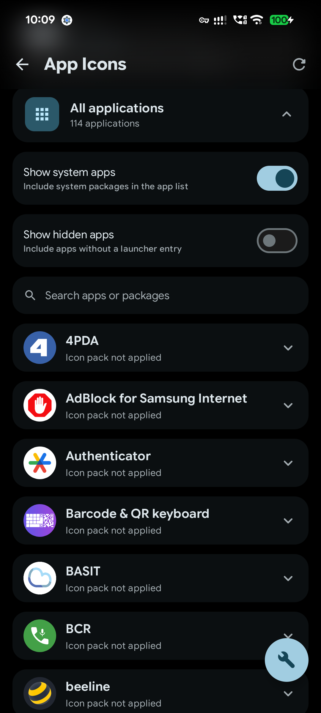
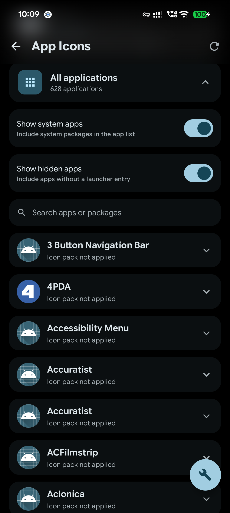

📱 Карточка приложения (Chrome)

- **Current custom icon — Icon pack not applied.**
- **Import custom icon, Choose from icon pack.**
- **Individual shape settings** — overrides только этого приложения.
- Группы: **Settings, Notifications, Pixel Launcher.**
- Везде: **Stretch to shape — OFF, Remove shape — OFF, Shape scale — 72.00%.**
- Подсказка: *0% прячет, 72% норма, 200% перебор.*
- Внизу: **Use global / Save settings.**
- **Available icons** — строки пака с **Apply**.

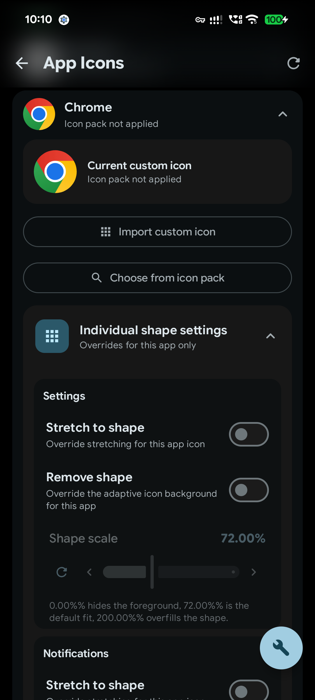
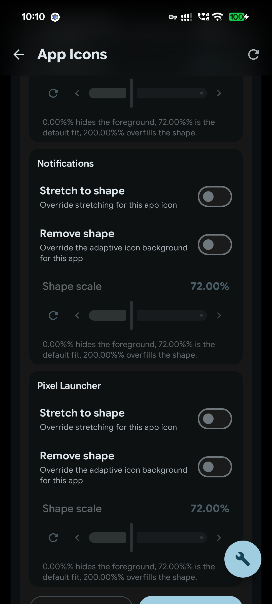
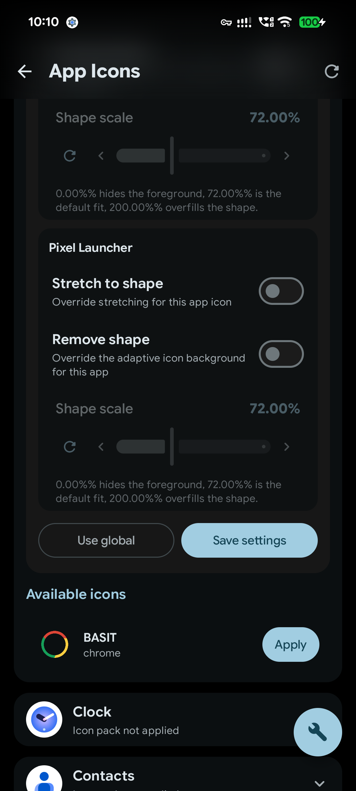

🔍 Выбор из пака

Диалог **Choose from icon pack → Chrome**.
Поиск, **Detected alternatives**, **All pack icons**, **Apply** в строках, **Close**.

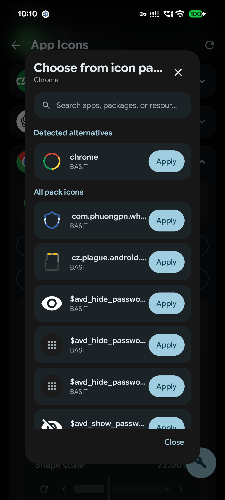

⚙️ Продвинутые иконок

- **Core toggles** — Enable icon system — ON, Apply in Pixel Launcher — ON.
- **Shape and scale** — Stretch / Remove для system, notifications, launcher — на скринах OFF, шкалы **72.00%**.
- **Tinting** — Background tinting **Off**, цвет `#00000000` + Pick (недоступно), Icon tinting **Off**, цвет `#FFFFFFFF` + Pick (недоступно).
- **All Apps and per-app shapes** — Workspace matches All Apps OFF, Ignore per-app shapes OFF, All Apps follows workspace OFF, Themed in All Apps OFF, Themed in suggestions OFF.

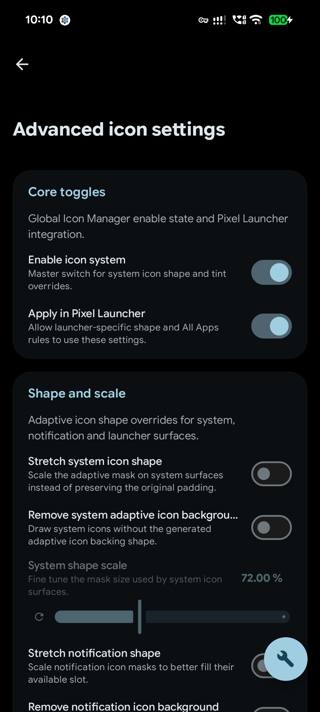
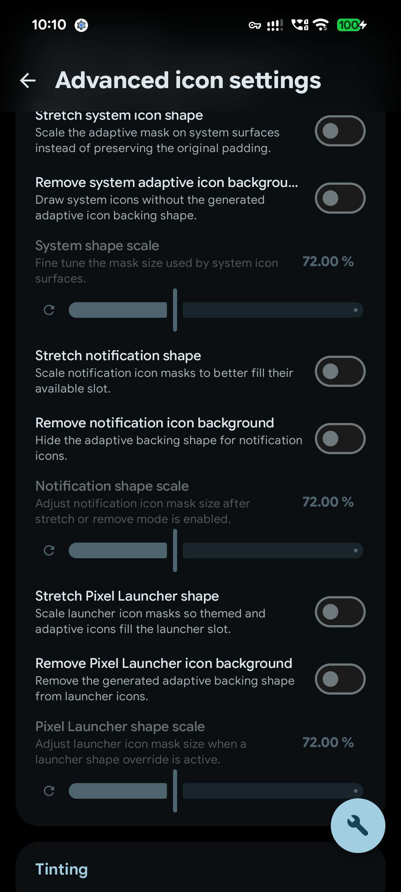
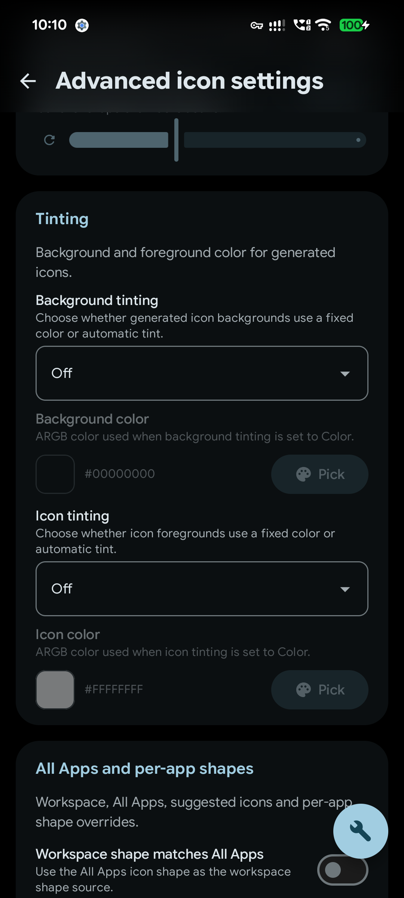
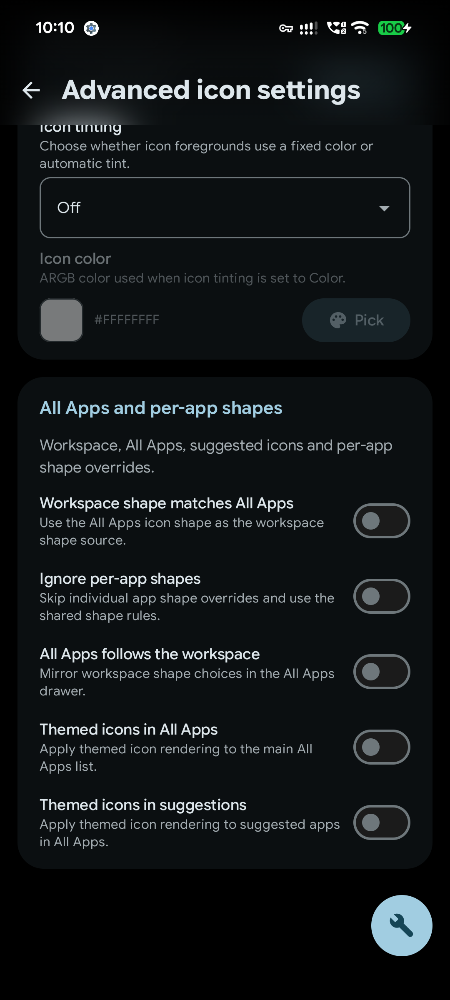

🏠 Вид иконок Настроек

**Use global Settings icon shape — ON.**
Цвета Настроек остаются, углы заменяются глобальной маской.

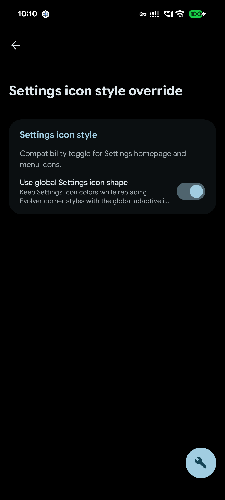

✨ Свой конструктор формы

- Превью + **Shape name — PixelParts custom** + **Build**.
- Вкладки **Squircle / Polygon / Flower**.
- **Roundness 4.50, Inset 0.00, Rotation 0.00, Width 1.00, Height 1.00, X 0.00, Y 0.00.**
- **Import + Build imported.**

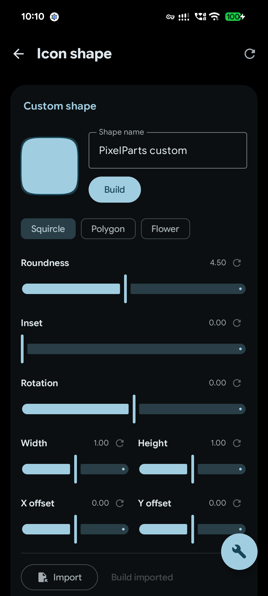

📦 Пресеты формы

- **Default — System default — Active.**
- Установленные: **Arch, Leaf, Meow…** с **Apply**.
- Встроенные с **Build**: Rounded rectangle, Squircle, Square, Hexagon, Teardrop, Tapered rectangle, Pebble…

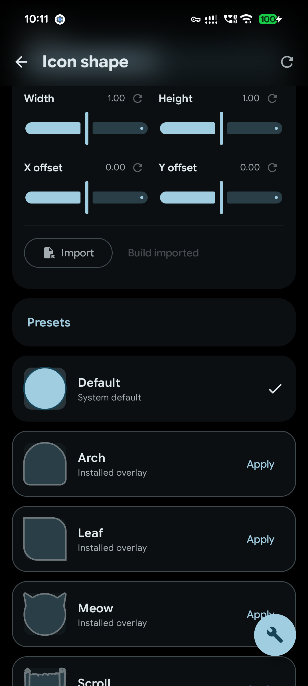
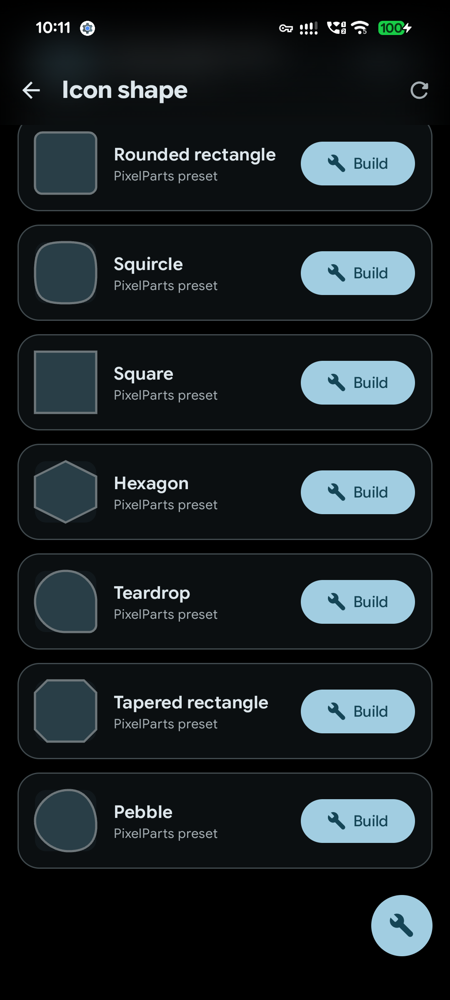

---

## Система

`Pixel Extra Parts → SystemUI Settings`

📂 Хаб System + логи

- **Module Settings** — Lock screen, Shade and QS, Notification icons.
- **Background Logging** — **Log in background — Start, Process is stopped.**
- **Log logcat — ON, Log dmesg — ON, Catch app crashes — OFF.**
- Логи в `/sdcard/PixelExtraPartsLogs/Date`.
- Далее: **Text Magnifier, Activity Transitions, Rotation Animation.**

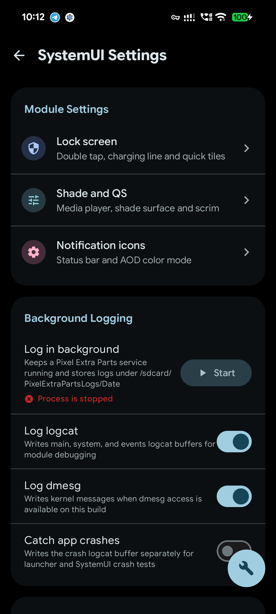
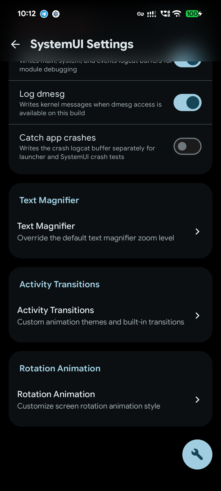

⚡ Зарядка на локскрине

Экран **Lock screen → Charging info**.

- **Show charging data — ON.**
- **Refresh interval — 1000 ms.**
- **Average readings — OFF.**
- **Standard string — ON, Custom symbol — ON, Symbol — ⚡.**
- **Power — ON, Voltage — ON, Current — ON, Temperature — ON, Percent — OFF.**
- **Quick Settings tiles — Charging info tile — Bind tile.**

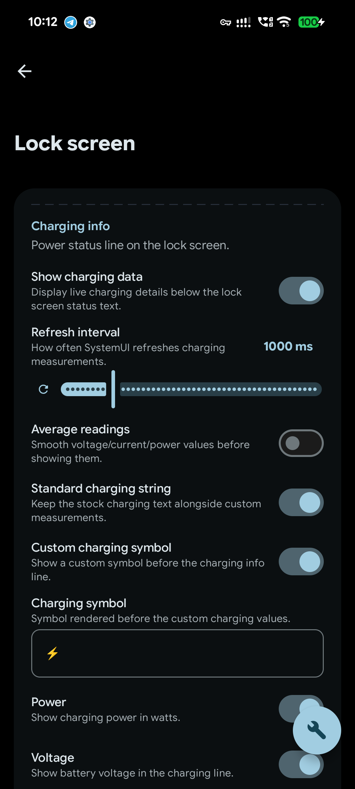
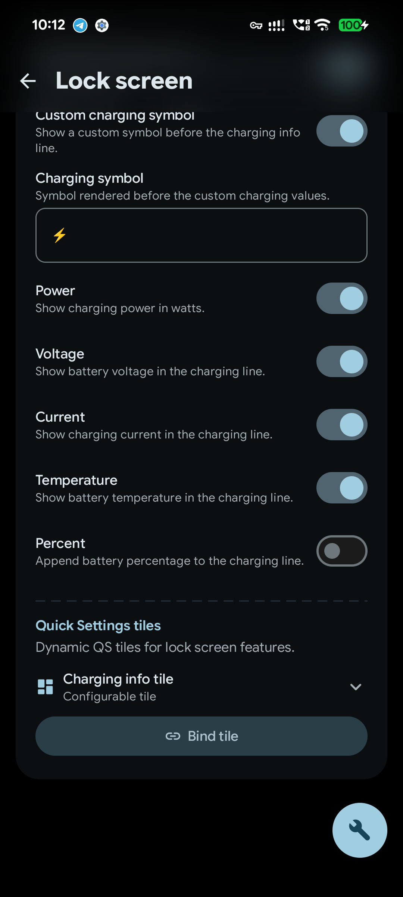

🔆 Шторка и плеер

Экран **Shade and QS**.

- **Shade tweaks — ON** (выкл = сток).
- **QS header — Date opens Calendar — ON.**
- **QS media player** — Background opacity **1.00**, Compact mode **Mini**.
- **Hide in QS — OFF, Hide in notifications — OFF, Hide on lockscreen — OFF.**

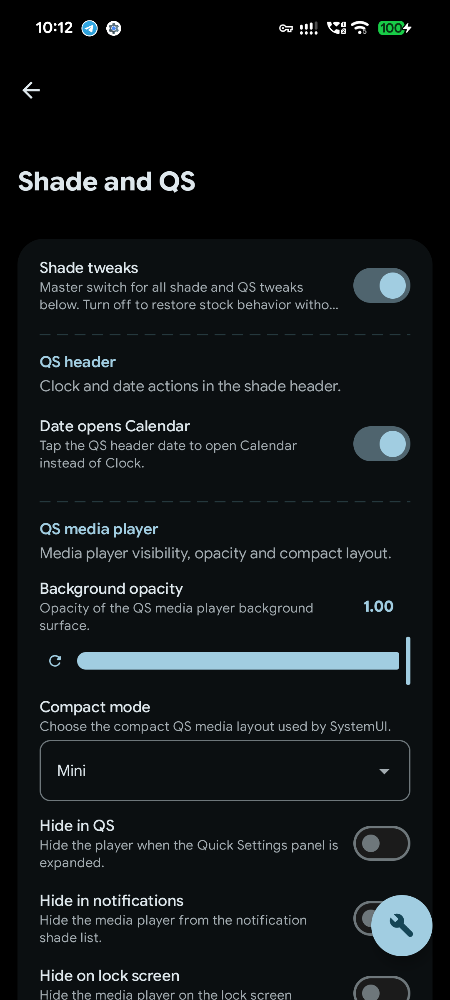
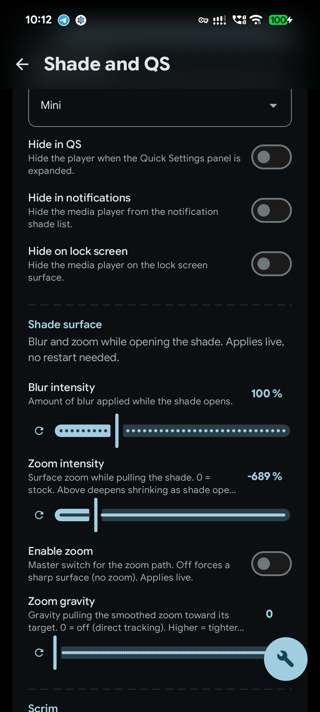

🌫 Поверхность и затемнение

- **Shade surface** — живьём, без рестарта.
- **Blur intensity — 100%.**
- **Zoom intensity — −689%.**
- **Enable zoom — OFF** (выкл = резко).
- **Zoom gravity — 0** (0 = прямое следование).
- **Scrim** — Notification **−1%**, Main **−1%** (−1 = системное).
- **Tint notification / main — OFF**, цвета **0** + Pick (недоступно).

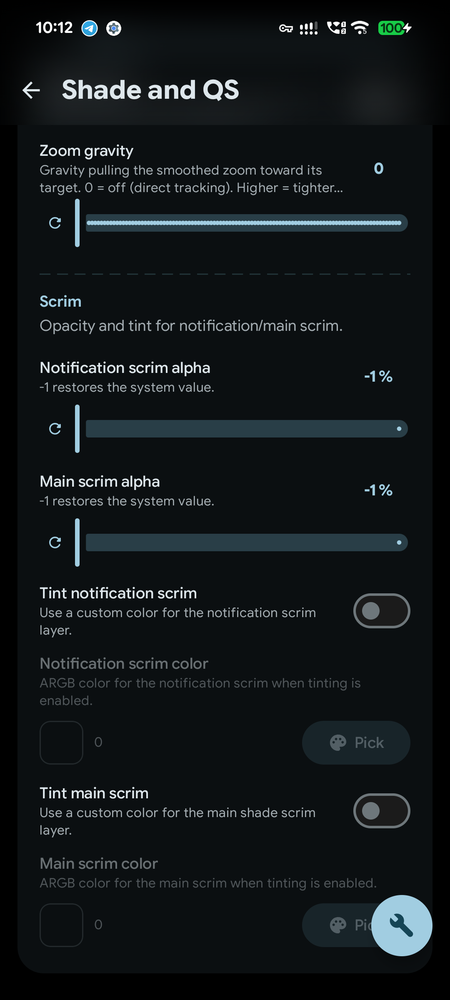

🔔 Иконки статус-бара и AOD

Экран **Notification icons**.

- **Status bar — Use app icons — ON, Monochrome — OFF.**
- **AOD — Use app icons — ON, Monochrome — ON, Legacy full color — OFF.**

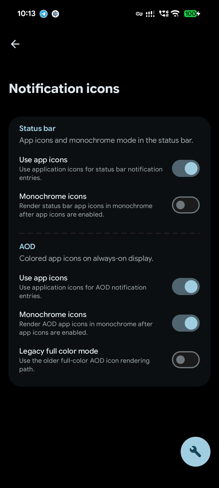

🔍 Лупа текста

Экран **Text Magnifier**.

- **Custom zoom — OFF** (остальное серым).
- **Zoom 1.25x, Window 1.00x.**
- **Window shape — Default** (ниже Square, Circle).
- **Vertical offset — 0dp.**
- Поле sample-текста + **Preview**.

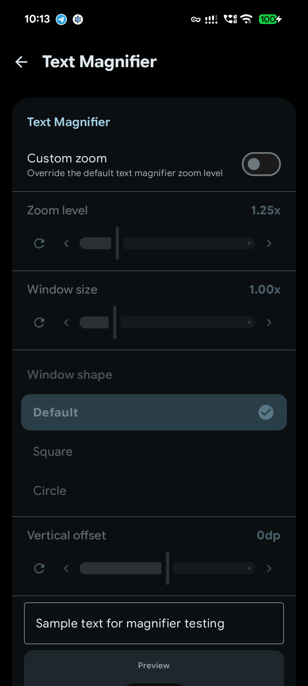

🎬 Анимации открытия / закрытия

Экран **Activity Transitions**.

- **Disable Predictive Back — ON.**
- Статус: **Current open: Depth — Bottom / Current close: Depth — Bottom**, пилюля **Disabled**.
- **Built-in Animations — No Animation** с Apply Both / Open / Close.
- Свернутые строки: Slide Right / Left / Top / Bottom…
- Раскрытый **Slide — Right**: превью Open / Close, те же три кнопки.
- **Installed Themes — No animation themes installed.**
- **Create Animation Theme** — Style name, вкладки **File / XML Text**,
  строки Open Enter / Open Exit / Close Enter / Close Exit,
  **Compile & Install** (серая, пока файлы не выбраны).

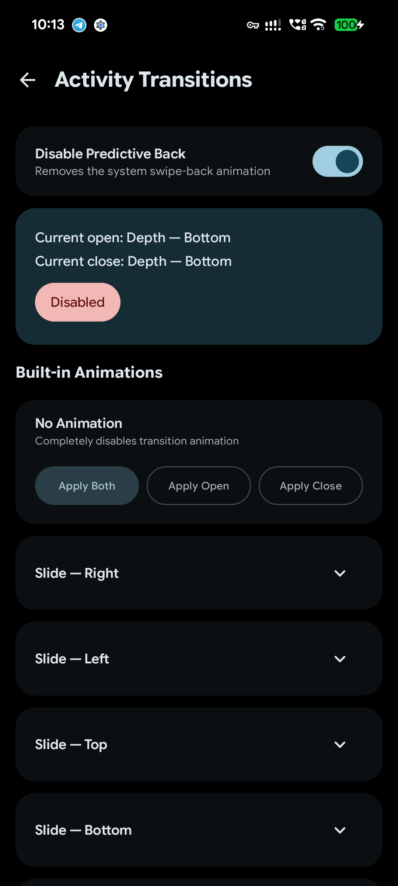
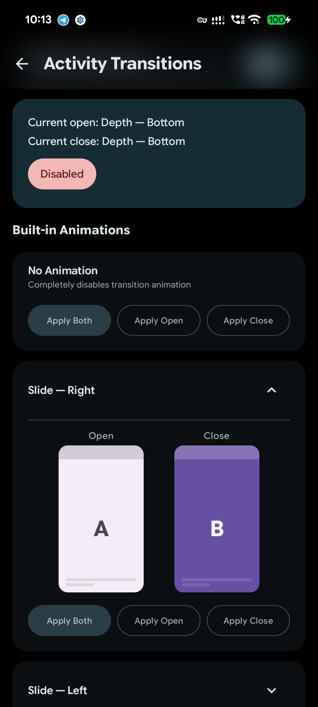
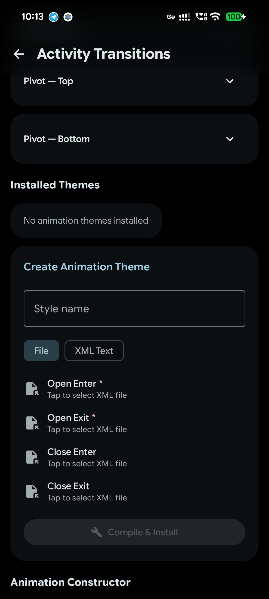

🧱 Конструктор анимаций

Вкладки **Open Enter / Open Exit / Close Enter / Close…**.

- **Translate** fromX / toX / fromY / toY.
- **Scale** fromX / toX / fromY / toY (на скрине 1.00).
- **Alpha** from / to (1.00).
- **Rotate**, **Timing duration 350 ms / offset 0 ms**, **Interpolator Linear**.
- **Preview** с двумя телефонами.
- **Build Theme, Show XML.**

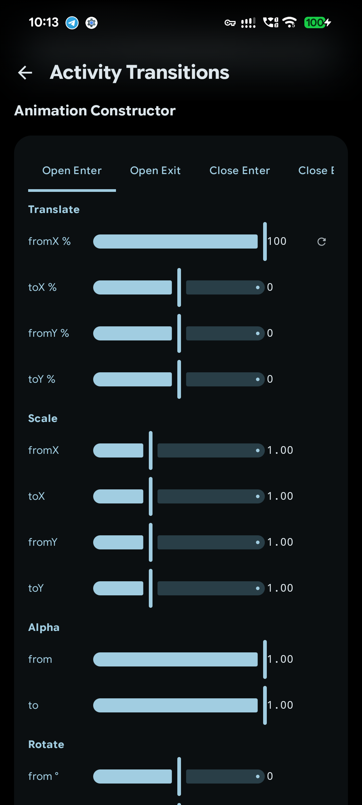
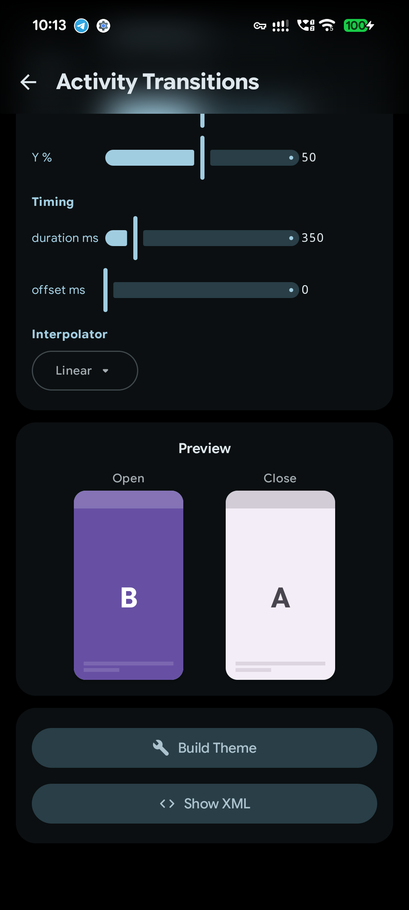

🔄 Стили поворота

Экран **Rotation Animation**.

- Статус: **Current: Windows 10/11**, **Reset to default**.
- **Built-in Styles** — Windows Phone, **Windows 10/11 — Active**,
  Cube, Zoom, Slide, Flip, Fade (+ Bounce ниже).
- Раскрытый стиль: превью + кнопка **Active**.
- **Custom Themes — No custom themes installed.**
- **Import Theme** — Style name, Exit / Enter (**No file selected**),
  **Build & Install** (серая).

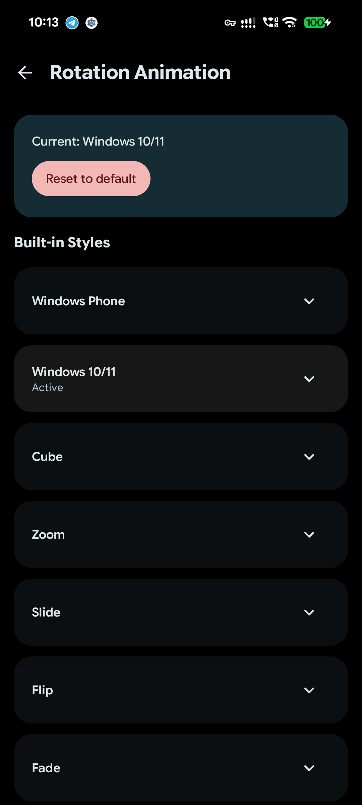
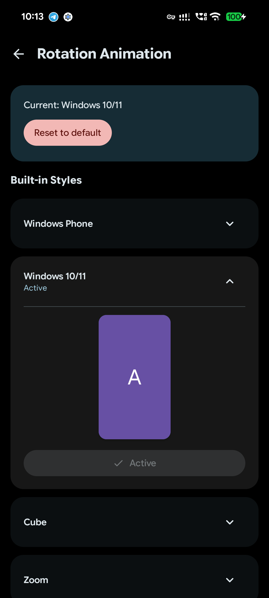
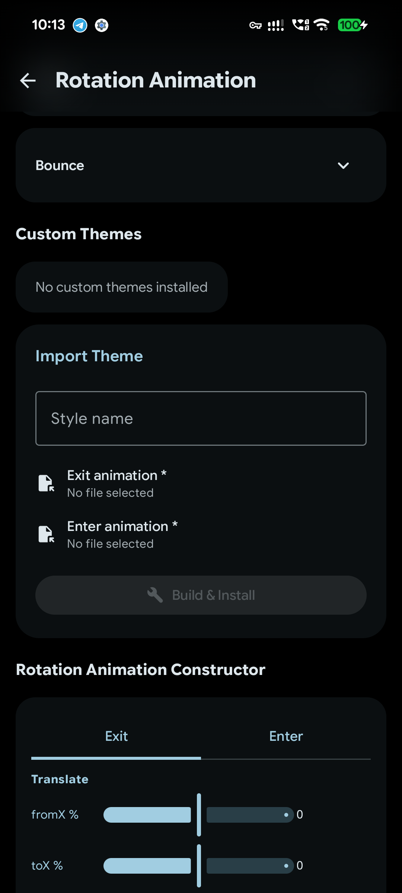

🧱 Конструктор поворота

Вкладки **Exit / Enter**.

- **Translate** fromX / toX / fromY / toY (нули на скрине).
- **Scale** везде 1.00.
- **Alpha from 1.00 to 0.00.**
- **Rotate from 0° to −90°.**
- **Pivot X 50 / Y 50.**
- **Timing duration 320 ms / offset 0 ms, Interpolator Linear.**
- **Rotation preview** с телефоном.
- **Build Rotation Theme, Show XML.**

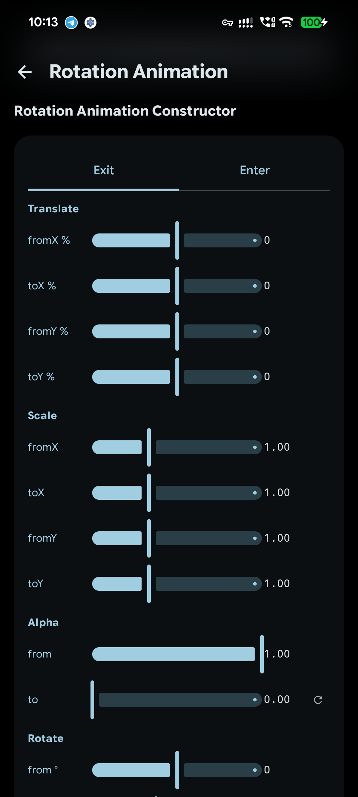
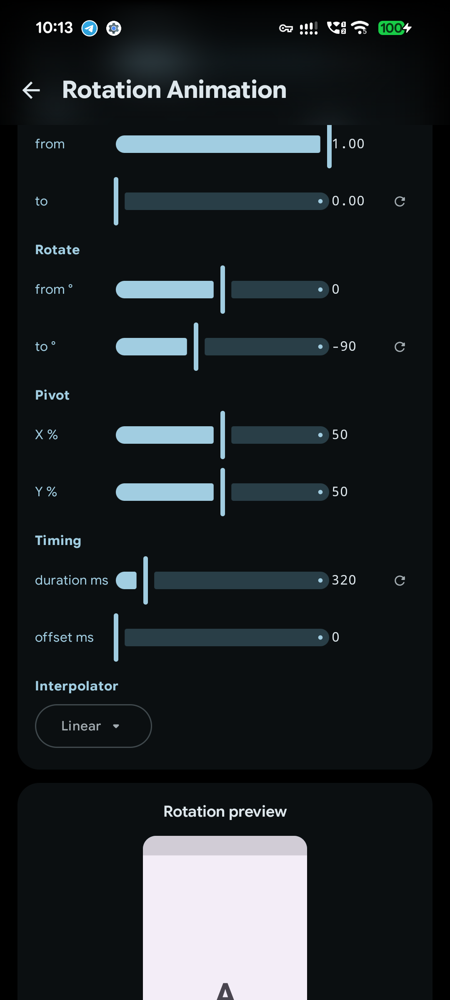
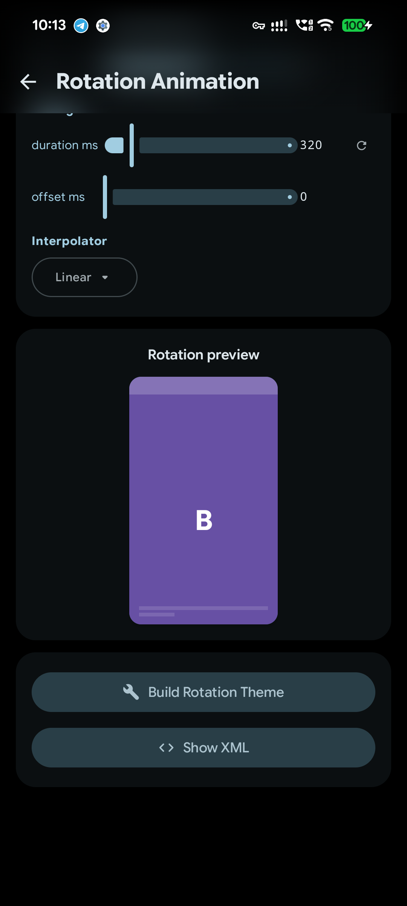

🌙 Ночной экран (Ambient Extend)

Экран **Ambient Extend**.

- **AOD blackout — ON, Delay 60 s, Fade 1200 ms.**
  Гасит always-on после тишины.
- **Smart Pixels — ON, Disabled pixels 72%, Mask shifting ON.**
  Меньше горящих пикселей, узор ездит против выгорания.
- **Doze dimming — OFF, сила 26%.**
  Доп. темнота в спящем режиме.

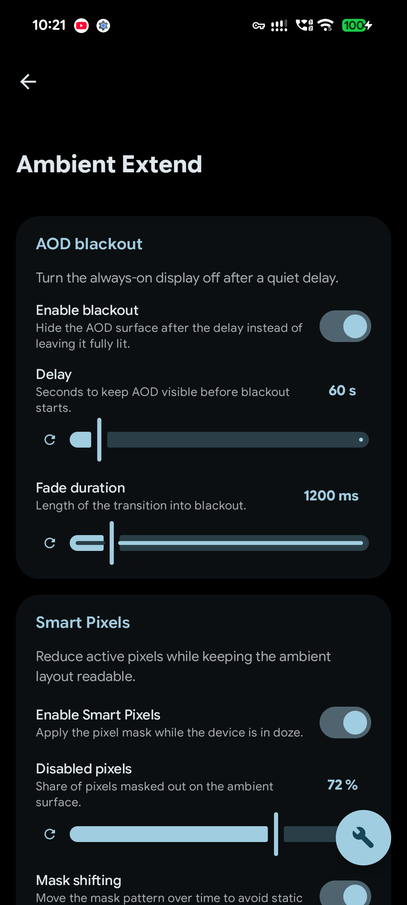
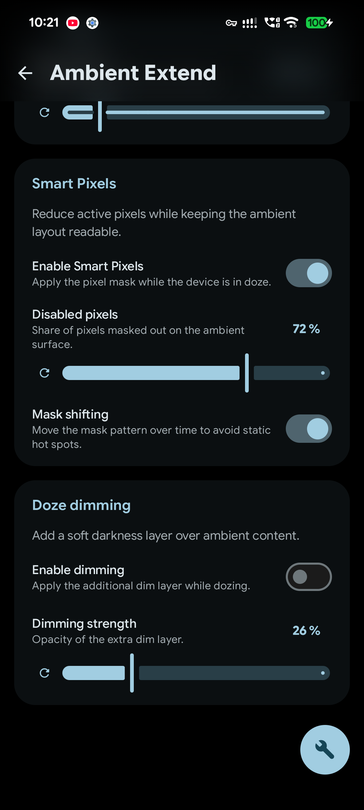

📷 Вспышка камеры

Экран **GCam Photo Torch → Photo flash controls**.

- **Enable Torch — ON.**
  Показывает пункт Torch в выборе вспышки фото Google Camera.

📶 СИМ / сеть (IMS Carrier Config)

Экран **IMS Carrier Config**.

- Плашка **System API path**.
- **Voice stack preset — ON** (VoLTE + Wi-Fi звонки + видео + UT разом).
- Кнопка **Clear carrier override**.
- **Voice services** — VoLTE, Wi-Fi calling, Video calling, Cross-SIM, UT — на скринах все ON.
- **Network services** — VoNR, 5G NR, 5G пороги — ON.

⚙️ Пункт в Настройках

Экран **Settings Homepage Item**.

- **Visibility and order** — Show Pixel Extra Parts — ON.
- **Settings position — −139** (меньше = выше в списке).
- **Icon style** — Colored icon — OFF.
- **Icon background — Auto**, Custom background `#67DDF7` + Pick (недоступно).
- **Glyph color — Auto**, Custom glyph `#0B3D4F` + Pick (недоступно).

---

## Лаунчер

📂 Хаб лаунчера

Экран **Pixel Launcher Settings → System**.

- Home screen
- Dock and search
- App drawer
- Gesture bar
- Recents
- Quick Settings tiles

🏠 Сетка дома + тап сна

Экран **Home screen**.

- **Home grid** — тумблер **OFF** на скрине.
- **Columns 5, Rows 6, Icon size 100%, Labels Default.**
- **Sleep gesture** — Double tap to sleep **OFF**,
  окно **250 ms**.

🔎 Док и поиск

Экран **Dock and search**.

- **Modify dock and search — OFF.**
- **Use native search — ON** (редиректится только поле поиска).
- **Dock icons 0** (0 = дефолт лаунчера), **Dock icon size 100%.**
- **Hide dock — OFF, Hide search — OFF.**
- **Offsets** — низ дома **−45 dp**, док **0**, поиск **0**,
  точки вертикаль **0**, горизонталь **0**.

🗂 Дравер

Экран **App drawer**.

- **Modify app drawer — OFF.**
- **Columns 5, Row height 100%, Icon size 100%, Labels Default.**
- **Suggestions** — Hide OFF, иконки подсказок 100%, подписи Default.
- **Search results** — иконки 100%, подписи Default.

➖ Геометрия нижней полосы

Экран **Gesture bar → Handle geometry**.

- **Enable tuning — ON.**
- **Width 28%, Height 4 dp, X 0, Y 0.**
- **Reserved area 24 dp, System gesture area 24 dp.**

👻 Прятание полосы + вид

- **Auto-hide** — дома **ON** (3000 мс),
  в приложениях **ON** (3000 мс),
  на локскрине **ON**, убрать резерв **OFF**.
- **Вид** — Opacity **58%**, появление **220 мс**, исчезновение **220 мс**,
  свой цвет **OFF**, цвет **#FFFFFF** + Pick.

📑 Хаб недавних

Экран **Recents → System**.

- **Task carousel** — масштаб, прозрачность, блюр, отступы.
- **Clear-all button** — место и ряд действий.

🌀 Карусель задач

Экран **Task carousel**.

- **Modify carousel — ON.**
- **Extra spacing −17 px, Min scale 0.93x, Min opacity 1.00.**
- **Card blur 12 px, Blur beyond bounds ON.**
- **Tint color #000000, сила 26%.**
- **Icon offset X 0 px, Y 0 px.**
- **Disable Live Tile ON** (статика),
  глобальный масштаб OFF, Scale 100%.

🧹 Кнопка очистки

- **Enable — ON.**
- **Hide Screenshot/Select — OFF.**
- **Button mode — Bottom.**
- **Bottom margin — 3.00x.**

🧷 Плитки лаунчера

Экран **Quick Settings tiles**.

- **Fixed tiles** — Double-tap sleep — **Not added**, **Bind tile**.
- **Configurable tiles** — Custom tile — **Bind tile**.

🙈 Скрытые приложения

Экран **Hide apps from launcher**.

- **System apps — ON.**
- Поиск, список **Applications** с чекбоксами (на скрине все пустые):
  4PDA, AdBlock, Authenticator, Barcode keyboard, BASIT, BCR, beeline, ByeByeDPI…
- Применить = перезапуск лаунчера.

---

## Эффекты скролла

`Scroll Physics`

🌊 Главное — профили и пружина

- **System Integration — Active — ON.**
- **Playground** — тестовые карточки.
- **Profiles** — Import / Export / Save / Online Configs.
- **Spring Physics** — Pull **1.51**, Stiffness **148.62**,
  Damping **1.00**, Fling **1.37**,
  Resistance **4.00**, Speed **168.52**.

📐 Группы деформации (на скринах Off)

- **Vertical** — Off / Shrink / Grow.
  0.31 / 0.38, лимит 0.10, опоры 0.50.
- **Zoom (XY)** — Off. 0.20 / 0.20, лимит 0.10, опоры 0.50.
- **Horizontal** — Off. 0.20 / 0.00, лимит 0.10, опоры 0.50.
- Пока Off — серым.

🔧 Тонко + на приложение

- **System Parameters** — Input Smooth 0.50, Min Velocity 8.00,
  Min Value 0.60, PULL 0.40, FLING 0.70, Compose Divider 3.33, Smart Pivot.
- **Compose Delta Smoothing — ON.**
  Hybrid, Reference 10.00, Multiplier 0.00,
  Correction 0.33, Window 2.00, Ramp 1.00.
- **App Configuration — Add Application.**
  На скрине: Pixel Launcher, Smoothing OFF, Disable ON, множитель 1.0.
- Кнопка **Reset Settings**.

---

## Нагрев — сразу, без перезагрузки

Переключается **за секунды на живом телефоне**.
Старые экраны могут предлагать ребут — просто жмите ОК, уже работает.

🌡 Общий + на игру + очередь

Экран **Thermals Manager**.

- **Global profile** — на скрине: **Battery +9c; Soc +90c — System —
  battery_medium_soc_off.json** (+ кнопка `+`).
- **Tile profile queue — 0/5 — Add profile — Queue is empty.**
- **Show system apps — ON**, поиск, **Application profiles**.
- Строка: 3 Button Navigation Bar — System — Global — тот же профиль.
- Тап по строке → выбор: **Follow global** (выбран на скрине),
  **Stock — thermal_info_config.json**,
  **Battery +15c, +15c/+15c, +15c/+5c, +15c/+90c, +15c/+9c, +5c…**
- Глобальный выбор — тот же список с галочкой.

Телефон смотрит открытое приложение **каждую секунду** и меняет сам.

🧪 Редактор конфигов

Экран **Config editor**.

- **Source: Vendor original.**
- **Profile name — Custom thermal.**
- **File name (optional)** — пусто, латиница сама.
- Вкладки **SOC / Battery / All** (на скрине All).
- **Save, Save and apply.**
- **Configurator — Showing 761 of 761 fields**, поиск,
  дерево Root 761: battery, BIG, cam_therm, cellular-emergency, charge_therm…
- Внутри: Coefficient, Combination,
  Formula MAXIMUM, HotHysteresis, HotThreshold, Multiplier 0.001,
  PassiveDelay 7000, PollingDelay 300000 — с бейджами **Known / Throttling**.

Системные locked — сначала клонировать.

---

## Модули

🧩 Список модулей (реальные скрины)

Экран **LSPlant Addons — 0 installed — Active: 8 of 8**.

- **Import Addon — Select a .jar file.**
- **Active Apps — 5 apps with hooks** (раскрывается:
  Settings 2, System UI 2 — Ambient Extend + SystemUI Hooks,
  Camera 1, Pixel Launcher 1, 4PDA 1).
- **System modules**:
  - Icon Manager Settings UI v2.0.1
  - Settings Homepage Item v2.0.1
  - GCam Photo Torch v2.0.1
  - Launcher hooks (nexuslauncher) — Merged scope
  - Ambient Extend v2.0.1
  - SystemUI Hooks v2.2.22
  - IMS Carrier Config v2.0.1
  - Settings Icon Style Override v2.0.1
- У каждого: версия, автор, id, описание, чип scope, вкл / выкл.
- Раскрытая карточка: **Module Settings + Import / Export / Check updates.**
- Тап по scope → **Target Scope: Default / Custom / Merge**,
  Default Targets (например com.android.settings), **Cancel / Save**.
- Свои цели → **Select apps** с Show system / Launchable only,
  поиск, чекбоксы, **Cancel / Confirm**.

---

## Плитки

Насыщенность, солнце-буст, постоянный буст, автоблок,
двойной тап, анимации, скролл, нагрев — крутит очередь,
зарядка, лупа, логи, хаб, плитки модулей.
Долгое нажатие на любую → её страница.

## Быстрые фиксы

Тумблеры не работают (иконки, лаунчер)

В сборке нет системной части. Патчи + пересборка чинят.

Лаунчер сломался после сетки / иконок

Плавающая кнопка → Restart Launcher.

Шторка не та

Мастер шторки выкл — сток вернётся сразу.

Буст сам гаснет

Страховка: лимит времени или температура с остыванием.

Модули пропали / safe mode

Три краша SystemUI за 3 минуты ставят модули на паузу.
Выключите подозрительный, выйдите из safe mode.

